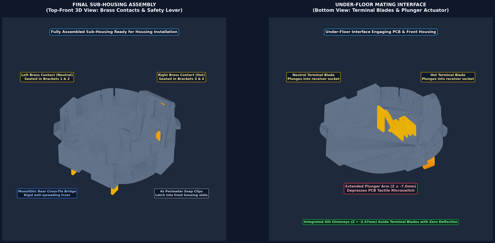
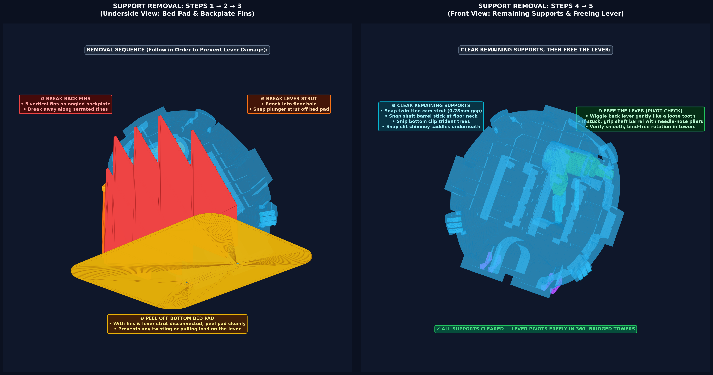

# Automotive 120V AC Outlet Sub-Housing & Safety Interlock Mechanism
## Parametric 3D CAD Model & Generator Documentation

This repository contains the complete parametric CAD generation pipeline for the intermediate sub-housing baseplate and safety rocker mechanism of an **in-cabin automotive 120V AC US power outlet assembly**.

---

## System Architecture & Functional Overview

The complete automotive AC power outlet assembly consists of three primary mating components:
1. **Front Outlet Receptacle Bezel / Faceplate**: Exposed inside the vehicle cabin, providing the standard US NEMA 1-15 / 5-15 AC plug slots.
2. **Intermediate Sub-Housing Baseplate & Rocker Mechanism (THIS REPOSITORY)**:
   - **Primary Function 1: Current-Carrying Busbar & Terminal Retention**: Securely locates and retains the formed copper/brass contact pieces and busbar strips within precision guide brackets (Brackets 1–4) and backside slit channels, transferring high AC current from the rear electronics module directly into the front receptacle prongs.
   - **Primary Function 2: Active Plug Insertion Sensing & Power Safety Interlock**: Integrates a spring-biased/pivot rocker mechanism mounted inside heavy-duty retention towers. When the **right plug prong (blade)** is inserted into the outlet, it physically depresses the rocker's angled input cam tab ($105^\circ$ direct rocker arm). This rotates the pivot shaft in its cradles, driving the extended plunger arm downward ($Z \le -6.50\text{ mm}$) through the baseplate floor pass-through hole into a PCB-mounted tactile microswitch. This signals the inverter/control module that a plug is physically seated, ensuring the outlet **delivers 120V AC power only when a plug is actively inserted** (preventing idle power draw and electric shock hazards).
3. **Rear Electronics / Inverter & Control Board Module**: Houses the DC-to-AC power inverter, logic controller, supply terminal feeds, and the momentary interlock switch.

---

## 1. Quick Start & Regeneration Commands

> [!TIP]
> For a concise, 1-page architectural reference containing all critical datums, coordinates, and layer stacks, see [ARCHITECTURE.md](file:///C:/Users/Elliot/Documents/antigravity/kind-bardeen/ARCHITECTURE.md).

To rebuild all 3D CAD assets and 2D/3D annotated blueprints from source:

```bash
# Build main baseplate CAD models (part.stl, part.obj, complete_assembly.stl)
py -3 build_part.py

# Build shaft/rocker mechanism (shaft_rocker.stl, shaft_rocker_clean.stl, etc.)
py -3 build_shaft.py

# Build anti-spreading tower prong clamps (accessories/tower_clamp/)
py -3 accessories/tower_clamp/build_clamp.py

# Generate high-resolution dimensioned feature blueprints (labeled_part_preview.png)
py -3 generate_labeled_preview.py

# Run primary production verification suite
py -3 testing/verify_exported_deliverables.py
py -3 testing/verify_shaft_supports_production.py
```

### Generated Output Files
| File | Description |
| :--- | :--- |
| **`part.stl`** / **`part.obj`** | Main baseplate with **100% planar flat bottom ($Z = 0.00\text{ mm}$)** for support-free 3D printing. Tower lateral faces are 100% clean and flat. Baseplate perimeter features top-down crowned snap clips ($L = 3.70\text{ mm}$, $1.80\text{ mm}$ center hook depth with $0.20\text{ mm}$ top-down continuous crown arc ease, shelf at $Z = 4.72\text{ mm}$, $0.53\text{ mm}$ prominent squared-off vertical blunt face, $0.60\text{ mm}$ slot width, $2.07\text{ mm}$ continuous solid hoop ring above floor) and an extended through-hole ($Y \in [8.57, 13.75]\text{ mm}$) for free plunger travel. |
| **`shaft_rocker.stl`** / **`shaft_rocker.obj`** | Separate 3D-printable enlarged heavy-duty shaft/rocker mechanism with **built-in sacrificial snap-off support frame** ($Z \in [0.00, 0.58]\text{ mm}$, $52.8\text{ mm}^2$ bed footprint, $0.12\text{ mm}$ pin release gap). Ready for 1-click printing with **slicer supports completely DISABLED**. Pre-oriented flat on build bed ($Z = 0.00\text{ mm}$). |
| **`shaft_rocker_clean.stl`** / **`shaft_rocker_clean.obj`** | Bare shaft/rocker mechanism without built-in supports (for reference or manual slicer tree supports). |
| **`shaft_rocker_assembled.stl`** | Shaft/rocker mechanism positioned in exact assembly coordinates seated in the towers. |
| **`shaft_rocker.scad`** | OpenSCAD parametric source file for the shaft/rocker mechanism. |
| **`slit_insert.stl`** / **`slit_insert.obj`** | Separate 3D-printable backside slit wall insert with enlarged, sliceable registration key (**$2.60 \times 4.80\text{ mm}$** with solid **$0.70\text{ mm}$ walls**, impossible to drop in slicing) and $0.60\text{ mm} \times 45^\circ$ non-breaching polarization corner bevel. |
| **`slit_inserts_pair.stl`** | Two inserts pre-arranged side-by-side on a single build plate for 1-click 3D printing. |
| **`cooling_tower.stl`** / **`cooling_tower.obj`** | Sacrificial cooling column ($\varnothing 4.00\text{ mm} \times 20.50\text{ mm}$ tall) to guarantee dedicated cooling time per layer on delicate baseplate tower tips ($Z = 15.59\text{ mm}$) and shaft rocker tips ($Z = 19.86\text{ mm}$). |
| **`complete_assembly.stl`** / **`complete_assembly.obj`** | Complete 1-click 3D print plate with the main baseplate, both separate slit inserts, shaft rocker, and sacrificial cooling tower pre-arranged side-by-side on the **same flat print plane ($Z = 0.00\text{ mm}$)** with wide thermal isolation spacing ($>16\text{ mm}$ clearance). |
| **`accessories/tower_clamp/`** | Standalone optional anti-spreading tower prong clamps (`tower_clamp_bridge.stl`, `tower_clamp_left.stl`, `tower_clamp_right.stl`, `tower_clamps_pair.stl`). Preserved separately as an auxiliary accessory. |
| **`slicer/`** | Pre-configured Bambu Studio / OrcaSlicer project files (`complete_assembly_printed.3mf`). |
| **`testing/`** | Comprehensive verification, kinematic analysis, and diagnostic suite. See [testing/README.md](file:///C:/Users/Elliot/Documents/antigravity/kind-bardeen/testing/README.md) for test catalogue. |
| **`part.scad`** | OpenSCAD source file representing the exact baseplate geometry. |
| **`labeled_part_preview.png`** | 3-panel blueprint showing top-down dimensioned feature map, 3D isometric assembly, and kinematic stroke cross-section. |
| **`part_preview.png`** | 3-panel multi-angle view (Top-Down, 3D Perspective, Bottom View). |

---

## 2. Coordinate System & Global Units

- **Units**: All dimensions are in **millimeters ($\text{mm}$)**.
- **Origin $(0, 0, 0)$**: Geometric center of the main body circle/profile.
- **Scale Factor**: Calibrated from SVG pixel coordinates:
  $$\text{SCALE} = 0.349787\text{ mm/pixel}, \quad X_0 = 128.65\text{ px}, \quad Y_0 = 128.65\text{ px}$$
- **$Z$-Axis Elevations (Main Part)**:
  - $Z = 0.00\text{ mm}$: 100% Flat build-plate datum (zero support needed under main floor).
  - $Z \in [0.00, 1.00]\text{ mm}$: Solid base floor plate ($1.00\text{ mm}$ thick).
  - $Z \in [1.00, 1.50]\text{ mm}$: Internal floor stiffener grid ribs ($0.50\text{ mm}$ tall).
  - $Z \in [1.00, 4.60]\text{ mm}$: Guide brackets ($4.60\text{ mm}$ total height).
  - $Z \in [1.00, 6.77]\text{ mm}$: Outer perimeter wall, snap clip stems, bottom arch wall, and bridge rib ($6.77\text{ mm}$ height).
  - $Z \in [1.00, 10.50]\text{ mm}$: Center curved D-wall ($9.50\text{ mm}$ tall above floor, base extended to $Y = -5.05\text{ mm}$ as brass insert backstop).
  - $Z \in [1.00, 15.59]\text{ mm}$: Shaft support towers with thick rounded arch crown ($14.59\text{ mm}$ height above floor, apex at $Z = 15.59\text{ mm}$, monolithic cross-tie bridge).
- **Separate Slit Insert Dimensions**:
  - $Z \in [0.00, 2.47]\text{ mm}$: Wall body ($3.80\text{ mm} \times 5.60\text{ mm}$ outer, $1.20\text{ mm} \times 3.50\text{ mm}$ inner clearance channel for $0.77\text{ mm} \times 3.10\text{ mm}$ part).
  - $Z \in [2.47, 3.32]\text{ mm}$: Indexing registration key ($2.00\text{ mm} \times 4.30\text{ mm} \times 0.85\text{ mm}$) with continuous $1.20\text{ mm} \times 3.50\text{ mm}$ core.

---

## 3. Comprehensive Feature Specifications

```
                              TOP TAB (8.20mm Wide, fits 8.33mm Gap)
                              +-------------------+
                             /                     \
                            /   [TOWER 1] [TOWER 2] \  <-- Shaft Axis (Y = 9.28mm, Z = 12.59mm)
           Snap Clip (135°) |      (2.45mm throat)  | Snap Clip (45°)
                            |   [Through-Hole]      |
                            |   5.35 x 4.51 mm      |
                            |                       |
       Left Side Ear (7.70)-|   [BRACKETS]          |- Right Side Ear (7.70mm Wide, fits 8.30mm Gap)
                            |   [CENTER ARCH WALL]  |
                            |   (10.50mm tall)      |
          Snap Clip (211.3°)|                       | Snap Clip (327.5°)
                            \   [SLIT 1]  [SLIT 2]  / (4.42mm from ears, 8.47mm from tabs)
                             \  1.20x3.50 1.20x3.50/
                              +---+             +---+
                              |   | [U-ARCH 5mm]|   |
                              |   | (7.95mm H)  |   |
                              +---+-------------+---+
                              LEFT TAB       RIGHT TAB
```

### 3.1. Bottom Central U-Arch & Inset Wall (Config 1)
- **Arch Interior Clearance Width**: **$5.00\text{ mm}$** ($R_{\text{inner}} = 2.50\text{ mm}$, centered on $X \in [-2.50, +2.50]\text{ mm}$).
- **Arch Wall Thickness**: **$1.20\text{ mm}$** ($R_{\text{outer}} = 3.70\text{ mm}$, $X \in [-3.70, +3.70]\text{ mm}$).
- **Total Outer Height in $Y$**: **$7.95\text{ mm}$**
  - Base at Inset Bottom Exterior Wall: $Y = -16.650\text{ mm}$
  - Outer Arch Apex: $Y = -8.700\text{ mm}$ ($-16.650 + 7.950\text{ mm}$)
  - Inner Arch Apex: $Y = -9.900\text{ mm}$ ($6.75\text{ mm}$ inner clearance height)
  - Semicircle Arc Center: $Y = -12.400\text{ mm}$ (Straight tangent legs: $4.25\text{ mm}$ in $Y$).
- **Inset Bottom Exterior Wall Notch**:
  - Inset depth: $1.889\text{ mm}$ in $+Y$ (from bottom tabs at $Y = -18.539\text{ mm}$ to inset wall at $Y = -16.650\text{ mm}$).
  - Notch outer sidewalls: placed at **$X = \pm 2.500\text{ mm}$**, aligning with the **interior sidewalls of the arch**.
  - Floor: Solid continuous $1.00\text{ mm}$ floor within the inset wall.

### 3.2. Shaft Support Towers with Enclosed 360° Teardrop Sockets & Thick Rounded Crown (Print-in-Place)
- **Shaft Axis**: **$Y = 9.279\text{ mm}$, $Z = 12.590\text{ mm}$** ($\varnothing 3.50\text{ mm}$ teardrop journal bore, centered directly over the through-hole).
- **Left Tower**: $X \in [3.900, 5.400]\text{ mm}$ ($1.50\text{ mm}$ wall thickness).
- **Right Tower**: $X \in [13.100, 14.600]\text{ mm}$ ($1.50\text{ mm}$ thickness, $0.14\text{ mm}$ clearance right of through-hole).
- **Internal Clearance Between Towers**: **$7.70\text{ mm}$** (accommodates $6.90\text{ mm}$ hub barrel with $0.40\text{ mm}$ lateral clearance per side).
- **Enclosed 360° Journal Sockets**:
  - Bore: Teardrop profile ($\varnothing 3.50\text{ mm}$ circular bottom, $45^\circ$ self-supporting angled apex oriented at $135^\circ$ in Y-Z so that under $45^\circ$ print tilt, the apex points vertically upward, eliminating bridging sag).
  - Clearance: $0.35\text{ mm}$ radial running clearance around $\varnothing 2.80\text{ mm}$ axle pins, completely eliminating thermal fusing during FDM printing.
- **Thick Rounded Arch Crown**:
  - Profile: Smooth continuous elliptical/rounded arch in the Y-Z plane ($R_y = 2.85\text{ mm}, R_z = 3.00\text{ mm}$, tangent to vertical lands at $Y = 6.43\text{ mm}$ and $Y = 12.13\text{ mm}$).
  - Tower Total Height: **$14.59\text{ mm}$ above floor (apex at $Z = 15.59\text{ mm}$)**.
  - Solid Roof Thickness: **$1.25\text{ mm}$ of 100% solid plastic** over the top of the bore ($Z \in [14.34, 15.59]\text{ mm}$), providing immense hoop strength and resistance to upward plug prying forces.
- **Monolithic Rear Cross-Tie Bridge**:
  - Spans the entire $7.70\text{ mm}$ inter-tower gap across $X \in [5.40, 13.10]\text{ mm}$ at $Y \in [11.75, 12.85]\text{ mm}$ ($1.10\text{ mm}$ thick in Y) and $Z \in [12.60, 15.00]\text{ mm}$ ($2.40\text{ mm}$ tall in Z).
  - Permanently and rigidly locks the two towers together, 100% eliminating tower spreading under plug insertion forces without requiring secondary external clips.
- **Left Tower Dual Lateral Buttress Struts**:
  - **Front Strut**: Base meets the top inner wall of Bracket 3 at **$Y = 6.250\text{ mm}$** ($X \in [1.90, 3.90\text{ mm}]$, $Y \in [6.250, 7.050\text{ mm}]$), sloping directly into the Left Tower at $Z = 13.70\text{ mm}$ with **zero encroachment into Bracket 3's sliding channel**.
  - **Rear Strut**: Full-height triangular rib ($1.20\text{ mm}$ thick in $Y$ at $Y \in [11.650, 12.850\text{ mm}]$, $X \in [1.90, 3.90\text{ mm}]$, $Z \in [1.00, 13.70\text{ mm}]$).
- **Right Tower Reinforcing Bridge Rib**: Spans $X \in [13.10, 20.00]\text{ mm}$ at $Y \in [7.50, 13.00]\text{ mm}$, connecting directly to the outer perimeter wall.

### 3.3. Curved Snap Clips (4x at $45^\circ, 135^\circ, 211.3^\circ, 327.5^\circ$)
- **Perimeter Positions**:
  - Top pair: $45^\circ$ and $135^\circ$ (halfway between top tab and side ears).
  - Bottom pair: **$211.3^\circ$ and $327.5^\circ$** (**$4.42\text{ mm}$ from respective side ears, $8.47\text{ mm}$ from respective bottom tabs**).
- **Wall Following**: Matches the exact curved contour of the outer ($R \approx 19.25\text{ mm}$) and inner ($R \approx 18.05\text{ mm}$) wall with full $1.20\text{ mm}$ solid beam thickness.
- **Beam Dimensions & Restored Sturdy Geometry**:
  - **Cantilever Beam Length**: **$L = 3.70\text{ mm}$** ($Z \in [3.07, 6.77]\text{ mm}$), restoring the proven robust flex architecture of earlier stable iterations.
  - **Continuous Solid Perimeter Hoop Ring**: Preserves a **$2.07\text{ mm}$ unbroken ring** ($Z \in [1.00, 3.07]\text{ mm}$) above the base floor. This anchors the perimeter wall in continuous hoop tension, completely eliminating stress concentration at the thin floor boundary and preventing layer delamination/snapping under bending moments.
  - **Widened Flex Slots**: Increased slot width to **$0.60\text{ mm}$** (`CLIP_SLOT_CLEARANCE = 0.60`). Completely eliminates inter-wall micro-fusion and filament bridging during FDM printing that previously caused tearing along layer lines.
- **Top-Down Crowned Retention Hook Overhang ($1.80\text{ mm}$ Depth, $0.20\text{ mm}$ Crown Ease)**:
  - Undercut retention shelf at $Z = 4.72\text{ mm}$ ($+0.25\text{ mm}$ material under shelf for positive switch engagement) projecting **$+1.80\text{ mm}$ radially outward at center** (`CLIP_HOOK_DEPTH = 1.80`), providing robust retention during disassembly while maintaining reasonable insertion force in the mating enclosure windows.
  - **Top-Down Subtle Continuous Crown Arc (`CLIP_CROWN_EASE = 0.20`)**: Looking top-down in the XY plane, the hook edge follows a smooth parabolic/cosine crown arc tapering from $1.80\text{ mm}$ at the center to $1.60\text{ mm}$ at lateral edges. This eliminates sharp $90^\circ$ biting corners that previously gouged the circular receptacle bore during insertion.
  - **Prominent Vertical Squared-Off Blunt Land ($0.53\text{ mm}$ Height)**: Features an enlarged **$0.53\text{ mm}$ vertical solid blunt face** at the outer apex ($Z \in [4.72, 5.25]\text{ mm}$, `CLIP_BLUNT_HEIGHT = 0.53`), permanently eliminating knife-edge fragility and layer splitting under insertion forces.
  - Sloped lead-in ramp tapering from the blunt land ($Z = 5.25\text{ mm}$) up to the top outer wall apex at $Z = 6.77\text{ mm}$ ($1.52\text{ mm}$ vertical span, flattens lead-in angle to $49.0^\circ$ for smooth entry).
- **Built-In Sacrificial Support Towers (Twin-Prong Breakaway Fork Supports)**:
  - Sturdy base sitting flat on print bed ($Z = 0.00\text{ mm}$) with a wide adhesion foot ($1.80\text{ mm} \times 3.80\text{ mm}$) and solid lower trunk ($1.20\text{ mm} \times 3.40\text{ mm}$) up to $Z = 3.20\text{ mm}$.
  - **Twin Lateral Prongs & Prying Arch**: Splits into two vertical prongs centered at $Y = \pm 1.40\text{ mm}$ spanning across a $1.80\text{ mm}$ wide central prying arch window ($Z \in [3.20, 4.82]\text{ mm}$), directly supporting the outer lateral shelf corners ($0.25\text{ mm}$ margin to edges).
  - **Equal Contact Area ($0.90\text{ mm}^2$)**: Twin chisel breakaway tips ($2 \times [0.50\text{ mm} \times 0.90\text{ mm}] = 0.90\text{ mm}^2$) at $Z = 4.94\text{ mm}$ ($0.03\text{ mm}$ micro-gap under the $Z = 4.97\text{ mm}$ shelf). Completely prevents edge droop while allowing effortless tool prying with zero marring.

### 3.4. Center Curved Feature with Reinforced Solid Core (Option 1)
- **Position**: Centered between Brackets 3 & 4 at $X_c = +6.279\text{ mm}$.
- **Width**: $4.30\text{ mm}$ ($X \in [4.129, 8.429]\text{ mm}$).
- **Depth in $Y$**: $1.62\text{ mm}$ (Base: $Y = -4.069\text{ mm}$, Apex: $Y = -2.449\text{ mm}$).
- **Offset**: $2.00\text{ mm}$ in $+Y$ above the horizontal bracket step datum ($Y = -6.069\text{ mm}$).
- **Monolithic Solid D-Shape Structure**:
  - Replaced the fragile $0.60\text{ mm}$ hollow C-shell with a **100% solid infill cross-section** ($5.46\text{ mm}^2$ solid area, $+52\%$ material increase).
  - Closed the bottom ($-Y$) with a **continuous solid flat back wall** along $Y = -4.069\text{ mm}$.
  - Preserves the identical top outer arc ($R_x = 2.15\text{ mm}, R_y = 1.62\text{ mm}$, apex at $Y = -2.449\text{ mm}$) with $+2.16\text{ mm}$ clearance to the plug blade.
  - Guaranteed clearance to OEM brass insert: **$+0.58\text{ mm}$ air gap** to the brass crossbar and **$+0.28\text{ mm}$ air gap** to Seating Rib 4.
  - Increases bending moment of inertia $I_{xx}$ by $+52\%$ ($0.658 \to 1.000\text{ mm}^4$) and shear fracture load capacity by $>3.6\times$, eliminating layer shear failures during disassembly.
- **Total Height**: **$10.50\text{ mm}$** ($Z \in [1.00, 10.50]\text{ mm}$).

### 3.5. Guide Brackets & Brass Seating Ribs (Looser Tolerances & 1.15mm Support Ribs)
- **Left Pair (Brackets 1 & 2)**: $X \in [-10.791, -1.766]\text{ mm}$.
- **Right Pair (Brackets 3 & 4)**: $X \in [+1.766, +10.791]\text{ mm}$.
- **Relaxed Looser Interior Tolerances (Brackets 1–4)**:
  - **Spine Channel Width ($X$)**: Widened from $6.856\text{ mm}$ to **$7.156\text{ mm}$** (provides **$+0.416\text{ mm}$ total sliding clearance** / $0.208\text{ mm}$ per side for the $6.74\text{ mm}$ OEM stamped brass contact strip, eliminating FDM print friction).
  - **Top Lead-In Throat Opening ($X$)**: Widened to **$3.500\text{ mm}$** ($+0.32\text{ mm} \text{ to } +0.35\text{ mm}$ wider funnel for smooth contact spring blade entry).
  - **Bottom Step Opening ($X$)**: Widened to **$3.800\text{ mm}$** ($+0.34\text{ mm}$ wider gap to easily pass the S-curved terminal leg).
  - **Internal Vertical Span ($Y$)**: Extended from $12.336\text{ mm}$ to **$12.600\text{ mm}$** ($Y \in [-6.200, +6.400]\text{ mm}$) to prevent axial binding.
  - **Top Hook Lead-In & Pocket ($Y$)**: Lower hook face raised to **$Y = 4.950\text{ mm}$**, upper pocket ceiling raised to **$Y = 6.400\text{ mm}$** (preserving full **$1.450\text{ mm}$** positive retention pocket depth).
- **Bracket Seating Ribs ($1.15\text{ mm}$ Elevation)**:
  - **Height**: **$1.15\text{ mm}$** protrusion above the floor ($Z \in [1.00, 2.15]\text{ mm}$) to elevate the brass contact piece.
  - **Inward Extension**: **$1.80\text{ mm}$** from each interior spine wall on both brackets of each pair.
  - **Central Open Corridor**: **$3.556\text{ mm}$** wide open central clearance along $X = \pm 6.28\text{ mm}$ for contact blade pinching and terminal pin clearance.
  - **Four Longitudinal $Y$ Stations**:
    - **Rib 1 (Top)**: Centered at **$Y = +5.250\text{ mm}$** ($Y \in [4.950, 5.550]\text{ mm}$), bottom edge meets the hook corner at $Y = 4.950\text{ mm}$ flush, forming a square seating corner under each hook.
    - **Rib 2**: Centered at **$Y = +1.950\text{ mm}$** ($Y \in [1.650, 2.250]\text{ mm}$).
    - **Rib 3**: Centered at **$Y = -1.350\text{ mm}$** ($Y \in [-1.650, -1.050]\text{ mm}$).
    - **Rib 4 (Bottom)**: Centered at **$Y = -4.650\text{ mm}$** ($Y \in [-4.950, -4.350]\text{ mm}$).
- **Bracket Total Height**: $4.60\text{ mm}$ ($Z \in [1.00, 5.60]\text{ mm}$).
- **Nominal Wall Thickness**: $0.85\text{ mm}$ to $0.93\text{ mm}$.

### 3.6. Backside Slit Protruding Bosses & Press-Fit Detent Inserts (Approach B: 100% Untouched Wall & Polarized Key)
- **Mating Component Fitment**: Custom engineered to comfortably pass a **$0.77\text{ mm} \text{ (thick in X)} \times 3.10\text{ mm} \text{ (long in Y)}$** metal contact blade.
- **Continuous Internal Through-Channel**: Sized at **$1.20\text{ mm} \text{ (in X)} \times 3.40\text{ mm} \text{ (in Y)}$** through both the insert and baseplate (**$+0.43\text{ mm}$ in X, $+0.30\text{ mm}$ in Y** generous sliding clearance to eliminate FDM print shrinkage binding).
- **Exact Slit Alignments**:
  - Left Slit Socket: Centered at **$X = -7.853\text{ mm}, Y = -13.589\text{ mm}$** (centered on Bracket 1 datum line).
  - Right Slit Socket: Centered at **$X = +8.453\text{ mm}, Y = -13.589\text{ mm}$** (exact OEM design alignment matching the vehicle mating plug).
- **100% UNTOUCHED Main Housing Perimeter Wall**:
  - The outer perimeter wall is **100% solid, continuous, and uniform $1.20\text{ mm}$ thick everywhere from $Z = 1.00\text{ mm}$ to $6.77\text{ mm}$** with **zero pockets, zero reliefs, and zero notches**.
  - All clearance routing is handled entirely on the insert indexing key and matching baseplate floor socket.
- **Main Baseplate Detent Sockets**: Two **$2.20\text{ mm} \times 4.40\text{ mm}$** female detent sockets cut through the $1.00\text{ mm}$ baseplate floor with a **$45^\circ$ corner chamfer** on the bottom-right of the right socket (and bottom-left of the left socket) to contour along the inner perimeter wall with a **$0.35\text{ mm}$ clean clearance margin**.
- **Separate Slit Inserts (`slit_insert.stl` & `slit_inserts_pair.stl`)**:
  - **$2.20\text{ mm}$ Sloped Outer Shroud Body**: $15.8^\circ$ draft angle tapering from a $2.70\text{ mm} \times 4.80\text{ mm}$ base shoulder down to **$2.20\text{ mm} \text{ (width)} \times 4.20\text{ mm} \text{ (length)}$** at the outer bottom face ($Z = 0.00\text{ mm}$), ensuring the shroud sits flush inside the $X = 9.812\text{ mm}$ outer perimeter wall edge with zero collision.
  - **1-Way Polarized Chamfered Indexing Key**: $1.80\text{ mm} \times 4.00\text{ mm}$ raised boss ($0.85\text{ mm}$ tall, $Z \in [2.47, 3.32]\text{ mm}$) featuring a **$45^\circ$ chamfered indexing corner** that prevents inserting the part backwards or rotated $180^\circ$.
  - **Fit Clearance**: **$0.40\text{ mm}$ total clearance ($0.20\text{ mm}$ per side)** into the baseplate detent socket for smooth, firm press-fit seating without binding.
  - **Flush Horizontal Seating Shoulder**: Sits flat against the baseplate bottom face ($Z = 0.00\text{ mm}$).
- **Complete Assembly Build Plate Layout**: `complete_assembly.stl` arranges the main baseplate, both separate slit inserts, shaft rocker, and sacrificial cooling tower flat on the **same build plane ($Z = 0.00\text{ mm}$)** side-by-side for 1-click support-free 3D printing.

### 3.7. Left and Right Side Ears (8.20mm Width for 8.30mm Enclosure Gap)
- **Position**: Left Side Ear at $X \approx -21.075\text{ mm}$, Right Side Ear at $X \approx +20.200\text{ mm}$ (centered at $Y = 0.00\text{ mm}$).
- **Outer Width in $Y$**: **$8.20\text{ mm}$** ($Y \in [-4.10, +4.10]\text{ mm}$).
- **Mating Enclosure Gap**: $8.30\text{ mm}$ (leaves $0.10\text{ mm}$ total sliding clearance / $0.05\text{ mm}$ per side for a smooth, bind-free sliding fit into the chassis guide slots).

### 3.8. Top Tab (8.20mm Width for 8.33mm Enclosure Gap)
- **Position**: Symmetrically centered along $X = 0.00\text{ mm}$ ($X \in [-4.10, +4.10]\text{ mm}$, Top apex at $Y = 20.01\text{ mm}$).
- **Outer Width in $X$**: **$8.20\text{ mm}$**.
- **Mating Enclosure Gap**: $8.33\text{ mm}$ (leaves $0.13\text{ mm}$ total sliding clearance / $0.065\text{ mm}$ per side for a clean, centered fit into the chassis top indexing slot).

### 3.9. Internal Floor Stiffener Grid
- **Pitch**: $5.20\text{ mm}$ (in $X$) $\times 3.20\text{ mm}$ (in $Y$).
- **Thickness & Height**: $0.60\text{ mm}$ thick, $0.50\text{ mm}$ tall ($Z \in [1.00, 1.50]\text{ mm}$).
- **Connectivity**: Connects directly into outer perimeter walls; excluded under bracket pairs and bottom zone ($Y < -7.17\text{ mm}$).

### 3.10. Enlarged Heavy-Duty Shaft & Rocker Mechanism (PCB Button Actuator)
- **Pivot Axle & Structural Core**:
  - Precision $\varnothing 2.80\text{ mm}$ bearing ends ($R = 1.40\text{ mm}$, $0.10\text{ mm}$ radial clearance fit inside $\varnothing 3.00\text{ mm}$ tower cradles) snapping firmly through the $2.60\text{ mm}$ tower throat ($+47\%$ diameter, $4.72\times$ higher torsional rigidity over $\varnothing 1.90\text{ mm}$).
  - **$\varnothing 4.20\text{ mm}$ heavy-duty structural hub barrel** spanning $X \in [5.50, 13.00]\text{ mm}$ to eliminate shaft deflection, shear, or twisting under spring/switch load.
- **Heavy-Duty Filleted Output Plunger Arm**:
  - **Width in $X$**: Widened to **$4.40\text{ mm}$ in $X$** (centered at $X = 10.284\text{ mm}$ in the $5.35\text{ mm}$ through-hole with $0.48\text{ mm}$ lateral clearances).
  - **Root Thickness in $Y$**: Thickened to **$3.80\text{ mm}$ at the shaft junction** blending into the $\varnothing 4.20\text{ mm}$ central hub barrel to eliminate bending under plug prong insertion.
  - **Tip Contact**: Smoothly tapers to a $2.00\text{ mm}$ nose diameter ($R = 1.00\text{ mm}$) at the switch contact point.
  - **Reach & Stroke**: Reaches **$\ge 6.50\text{ mm}$ below the outer bottom face of the baseplate ($Z \le -6.50\text{ mm}$)**.
  - **Kinematics & Relief Clearance**: Rotates CCW around the $Y = 9.279\text{ mm}, Z = 12.590\text{ mm}$ pivot axis upon downward blade push, swinging the plunger into $+Y$ ($Y_{\text{rest}} = 10.48\text{ mm} \to Y_{\text{act}} = 13.12 - 13.87\text{ mm}$) to positively depress the $Y = 12.40\text{ mm}$ PCB tactile switch. The baseplate through-hole rear wall is extended $+0.67\text{ mm}$ rearward to $Y = 13.750\text{ mm}$ ($5.35 \times 5.18\text{ mm}$ window), providing guaranteed running clearance with zero floor binding.
- **High-Sensitivity Direct Belly Cam (Calibrated for 10.5mm Plug Blade Reach)**:
  - $2.70\text{ mm}$ wide full-strength input cam tab operating inside the OEM brass pinching contact gap, centered at $X = 6.28\text{ mm}$.
  - **Calibrated for $10.5\text{ mm}$ Plug Penetration**: Eliminates `DZ_CAM = 0.90` (which had mistakenly lowered the cam out of reach of the blade). Elevates the active cam ramp with a direct blend from the hub down to $(5.00, 10.00)$ and an active contact tip at $(1.50, 7.40)$.
  - **Crisp Switch Actuation**: As the blade tip reaches $Z_{\text{tip}} = 7.50\text{ mm} \to 7.00\text{ mm}$, the rocker rotates $\theta = 8.0^\circ \to 10.3^\circ$, translating the plunger horizontally by $+2.64\text{ mm} \to +3.39\text{ mm}$ ($Y = 13.12\text{ mm} \to 13.87\text{ mm}$), ensuring crisp, reliable switch depression past the $12.40\text{ mm}$ trip threshold.
  - Monolithic structural gusset web spanning continuously across the entire opening between the towers ($X \in [5.60, 12.90]\text{ mm}$).

---

## 4. Post-Processing, Support Cleaning & Assembly Guide

A straightforward, practical guide for cleaning up supports, freeing the captive print-in-place (PIP) safety lever, and assembling the outlet housing.



### Tools Needed
- **Flush cutters / snips**: For trimming support nubs and clearing tight spots.
- **Needle-nose pliers**: For pulling support struts and gripping the shaft if it needs a little help breaking free.
- **Medium flathead screwdriver**: For seating the tight brass terminal blades in Step 4.

---

### Step 1: Remove Supports & Free the PIP Lever
The part prints at a 45° angle with all supports built directly into the model (slicer supports should be turned off). Follow this exact removal order to avoid putting unwanted stress on the captive lever:


1. **Break the back fins**: Break the vertical support fins running along the angled backside of the plate away from the part body.
2. **Break the strut holding the lever**: Reach in and snap the support strut that holds the plunger arm (reaching up from the bottom pad through the floor hole).
3. **Peel off the bottom plate**: With the back fins and the lever strut disconnected, the bottom bed plate can now be peeled away cleanly in one piece without tugging on the lever.
4. **Remove the rest of the supports**:
   - Snap off the twin-tine strut under the cam tab.
   - Snap off the small support stick under the center shaft barrel.
   - Snip or snap off the support trees under the two bottom snap clips so the clip shelves are clean.
   - Snap off the small support saddles underneath the backside slit chimneys.
   - Clear out any loose support fragments so the lever has full room to travel.
5. **Free the lever**:
   - Gently wiggle the back lever back and forth like a loose tooth until it breaks free from the tower sockets.
   - If it feels very stuck, take a pair of needle-nose pliers, grip the center shaft barrel directly, and wiggle that to pop it loose.
   - Once it breaks free, swing it back and forth a few times. It should pivot smoothly with a little bit of side-to-side play.

---

### Step 2: Seat the Brass Contacts
1. **Left (Neutral) Contact**:
   - Drop the contact into Brackets 1 & 2.
   - Push it down until it sits flat against the floor ribs and catches under the bracket lips.
   - Make sure the terminal blade pokes straight down through the left floor slit chimney.
2. **Right (Hot) Contact**:
   - Drop the contact into Brackets 3 & 4.
   - The cam tab on the lever should sit centered in the gap of the brass throat.
   - Push the contact down onto its seating ribs, and make sure its terminal blade pokes through the right floor slit chimney.

---

### Step 3: Quick Motion Check
1. Push down on the cam ramp with a plug blade or small tool (simulating a plug being inserted).
2. Make sure the lever swings freely without binding or rubbing hard against Bracket 4 or the tower walls.
3. Check underneath: the plunger arm should swing through the floor cutout far enough to positively press the PCB tactile button.

---

### Step 4: Install into the Front Housing
Mating the sub-housing to the front housing/faceplate takes noticeable force because the brass terminal blades fit very tightly into their receiver contacts. Even small misalignments can make them hang up.

You have two options:

- **Option A: Direct Push**:
  - Line up the 4 outer snap clips with their matching **clip slots** in the front housing wall.
  - Push the whole plate straight in until all 4 clips snap home into the slots.
  - *Caution*: If the brass blades hit high resistance or are slightly crooked, pushing directly on the plastic plate can flex or snap the clips.

- **Option B: Screwdriver-Assisted Seating (Recommended)**:
  - Small misalignments can prevent this interface from mating properly, so pushing each blade directly into its receiver is good practice.
  - **How to do it**:
    1. Position the plate against the front housing so both brass blades start into their receiver slots.
    2. Take a flathead screwdriver and place the tip firmly against the solid shoulder/bridge of each brass blade.
    3. Push each blade directly into its receiver until it seats all the way in. This puts the heavy insertion force straight onto the metal blades rather than the printed plastic.
    4. Once both blades are fully seated, press the plate the rest of the way in until the 4 perimeter clips click flush into their **clip slots**.

---

### Step 5: Functional Testing
Once fully assembled with the PCB:
1. **Insert a Plug**: Push an AC plug into the receptacle. You should hear a clear, audible click as the button actuates.
2. **Test Multiple Times**: Test insertion several times, ideally with both a **polarized** and a **non-polarized plug**. The click should be audible on every single insertion.
3. **Troubleshooting (No Click Heard)**:
   If the switch is not clicking on plug insertion, check these two common culprits:
   - **Brass terminal blades are not fully inserted into their receivers**: If the blades aren't driven all the way in, the sub-housing won't sit at the right depth relative to the PCB switch. Use a flathead screwdriver to firmly push each blade home (Step 4 Option B).
   - **Brass contacts are not flush on the floor of the plate**: Check that both brass contact stampings are pushed all the way down onto the $1.15\text{ mm}$ floor ribs and locked under the bracket retaining lips. If a contact is riding high, the plug blade won't push the cam ramp far enough to trip the switch.

---

## 5. Key Scripts & Code Architecture

- **`build_part.py`**:
  - `get_exact_base_polygon()`: Parses SVG path, aligns bottom notch, and creates through-holes.
  - `create_arch_wall_poly()`: Builds the $7.95\text{ mm}$ tall, $5.00\text{ mm}$ inner width U-arch.
  - `build_clean_shaft_towers_mesh()`: Generates both towers with the $1.65\text{ mm}$ retention cradle.
  - `build_left_tower_struts_mesh()`: Creates the triangular buttress struts on the left tower.
  - `create_center_curved_feature_poly()`: Generates the $10.50\text{ mm}$ tall center feature.
  - `build_exact_3d_model()`: Assemblies all components and cuts flex slots into the wall.
  - `build_indexed_assembly_mesh()`: Places main baseplate, slit inserts, and shaft rocker flat on $Z = 0.00\text{ mm}$ print plate.
- **`build_shaft.py`**:
  - `build_shaft_rocker_mesh()`: Parametric generator for the shaft/rocker mechanism with customizable axle diameter, plunger reach ($Z \le -6.5\text{ mm}$), cam angle, and print bed orientation.
  - `export_shaft_scad()`: Generates parametric OpenSCAD source file (`shaft_rocker.scad`).
- **`generate_labeled_preview.py`**:
  - Generates the 3-panel labeled blueprint: Top-down feature map, 3D isometric assembly, and side kinematic stroke cross-section.
- **`testing/`**:
  - Dedicated directory containing unit tests, dimensional verification scripts, geometric exploration scripts, and inspection renders.

---

## 6. Development & Testing Guidelines

- **Testing Files Location**: All new test scripts, verification scripts, geometric inspection scripts, and one-off diagnostic visualization scripts/renders **must be created inside the `testing/` directory**.
- **Root Directory Cleanliness**: The project root directory is strictly reserved for core build pipeline generators (`build_part.py`, `build_shaft.py`, `generate_labeled_preview.py`), source geometry inputs (`part.svg`), final CAD exports (`.stl`, `.obj`, `.scad`), final documentation previews (`part_preview.png`, `labeled_part_preview.png`), and documentation (`README.md`).

---

## 7. Print Iteration History & Notes

### Version 6 (v6)
- **Tower Clip Snapping Fix**:
  - Relaxed retention cradle throat width from $2.05\text{ mm}$ to **$2.60\text{ mm}$** ($0.20\text{ mm}$ total interference with $\varnothing 2.80\text{ mm}$ shaft pin, $0.10\text{ mm}$ deflection per jaw).
  - Reduces insertion strain by **$73\%$**, preventing inter-layer delamination/snapping on 3D-printed cantilever jaws while maintaining a **$240.0^\circ$ positive retention wrap angle**.
  - Widened the top self-centering lead-in funnel to **$3.73\text{ mm}$** for smooth, guided downward insertion.
- **Shaft Rocker Support Reduction & Print Orientation**:
  - Reoriented `shaft_rocker.stl` to **Cam Face Down (`Rot X = 198.6°`)**.
  - Wide flat face of the input cam tab ($2.7\text{ mm} \times 6.8\text{ mm}$) rests directly on the build bed ($Z = 0.00\text{ mm}$), increasing bed contact area **$7\times$** ($25.48\text{ mm}^2$).
  - 3-rib fork array points upward, **completely eliminating trapped support material inside the narrow inter-rib slots**.
  - Pivot axle pins remain horizontal for maximum tensile/bending strength with zero support scars on the cylindrical bearing surfaces.

### Version 7 (v7)
- **Printed v7 Lever & Extended Heat Break Tower**:
  - Validated 3D printing of the reoriented v7 shaft/lever mechanism (`shaft_rocker.stl`).
  - Extended sacrificial cooling / heat break tower to **$20.50\text{ mm}$** ($\varnothing 8.00\text{ mm}$) to match and exceed the full $19.86\text{ mm}$ build height of the v7 lever, providing dedicated per-layer nozzle travel and thermal stabilization for the finest tips of both the lever plunger and baseplate retention towers.
- **Perimeter Snap Clips +1.00mm Radial Extension**:
  - Increased snap clip hook overhang depth from $1.59\text{ mm}$ to **$2.59\text{ mm}$** (`CLIP_HOOK_DEPTH`), providing deeper latch engagement into the mating female enclosure windows.
  - Centered and widened built-in breakaway sacrificial support pillars ($1.20\text{ mm} \times 2.20\text{ mm}$) directly beneath the $2.59\text{ mm}$ horizontal shelf overhang.
- **Convex Crowned Input Cam Profile**:
  - Upgraded the straight linear cam ramp on the shaft rocker to a **$+0.45\text{ mm}$ convex crown arc**.
  - Maintains continuous rolling tangency with the straight-inserted plug blade throughout dynamic rotation ($0^\circ \to 10^\circ$), preventing edge-digging and providing smooth, linear mechanical advantage.

### Version 8 (v8)
- **Direct Straight Belly Cam for OEM Brass Pinching Mechanism**:
  - Direct integration with the physical OEM stamped brass pinching contact clips in Brackets 3 & 4 (Hot Terminal: $6.74\text{ mm}$ wide in $X$, $14.40\text{ mm}$ tall above floor, $5.00\text{ mm}$ internal belly cavity, $1.00\text{ mm}$ pinch throat, $4.30\text{ mm}$ top V-flare opening).
  - **Re-centered on Hot Blade Axis**: Input cam centered precisely at **$X = 6.28\text{ mm}$**.
  - **100% Full Structural Width Preserved**: Retains the full **$2.70\text{ mm}$ width** in $X$ with $+2.02\text{ mm}$ lateral clearance inside the $6.74\text{ mm}$ brass strip boundaries (zero need to narrow the rocker).
  - **Direct Solid $2.80\text{ mm}$ Cantilever Beam**: Eliminates arched sections in favor of a straight, rigid structural beam sloping directly from the $\varnothing 4.20\text{ mm}$ hub barrel down into the $5.00\text{ mm}$ wide internal belly cavity ($Z \in [5.0, 7.5]\text{ mm}$).
  - **Kinematic Safety Interlock**: Contact initializes as the plug blade tip emerges from the $Z = 9.40\text{ mm}$ pinch throat at **$Z_{\text{tip}} = 7.20\text{ mm}$**, fully triggering the PCB tactile switch at **$Z_{\text{tip}} = 6.40\text{ mm}$ ($\theta = 6.15^\circ$)**.

### Version 9 (v9) & Reinforced Clamps
- **Side-Wrapping Anti-Spreading Tower Prong Clamps (`tower_clamp_left.stl`, `tower_clamp_right.stl`, `tower_clamp_bridge.stl`)**:
  - **Root Cause Remediation**: Permanently eliminates the primary OEM failure mode where the retention cradle prongs flex and spread apart in $Y$ under repeated plug insertion loads and EV cabin summer heat, allowing the shaft to unseat in $+Z$ and the interlock switch to fail.
  - **100% Solid Un-Notched Tower Prongs**: Zero cuts, notches, or grooves are added to the tower prongs. The prongs retain their full $1.50\text{ mm}$ wall thickness and monolithic structural integrity with zero notch stress concentrations at the root.
  - **Additive External Side Retention Ledges**: Adds a horizontal retention bead ($+0.70\text{ mm}$ in $X$, $Z \in [12.40, 13.60]\text{ mm}$) to the *outer lateral faces* of the towers ($X = 3.90\text{ mm}$ Left, $X = 14.60\text{ mm}$ Right). Because it is an additive outward bump on the lateral face, it adds material rather than thinning the prongs in their bending direction.
  - **Reinforced Heavy-Duty Anti-Flex Architecture**:
    - **Thickened Bridge Roof**: Increased from $0.90\text{ mm}$ to **$1.60\text{ mm}$** ($+78\%$ thickness, $>5.6\times$ higher out-of-plane bending stiffness).
    - **Reinforced Outer Cheeks**: Increased from $1.00\text{ mm}$ to **$1.60\text{ mm}$** (4 solid perimeters on a 0.4mm nozzle).
    - **Dual-Layer Continuous Backplate**: Outer $0.80\text{ mm}$ cheek is a 100% continuous solid plate spanning the entire $4.45\text{ mm}$ length in $Y$, backed by an inner $0.80\text{ mm}$ arched plate, completely eliminating the thin-wall hinge flexure.
    - **Thickened U-Saddle Tension Walls**: Increased from $1.15\text{ mm}$ to **$1.40\text{ mm}$** for extreme hoop constraint.
    - **Precision Snug Fit Across Prongs**: $5.67\text{ mm}$ inner span hugging the $5.63\text{ mm}$ tower top span with zero rattle.
  - **Positive Lateral Undercut Snap-Lock**: Dual inward snap hooks at $Z = 12.35\text{ mm}$ ($0.05\text{ mm}$ clearance past the $Z = 12.40\text{ mm}$ tower ledge) featuring a $35^\circ$ push-on lead-in chamfer. Once pushed down, it snaps under the additive side ledge with an audible, positive mechanical click.
  - **Zero Axle Pin Friction**: Pin tips end at $X = 3.45\text{ mm}$ (Left) and $X = 15.05\text{ mm}$ (Right), maintaining $\ge 0.25\text{ mm}$ clear air gap from the side cheeks. The pin rotates with complete, untouched freedom and **zero extra friction**.
  - **Positive Pin Hold-Down Keel**: Includes a central stabilizing keel descending to $Z = 14.02\text{ mm}$ directly into the throat funnel, maintaining a $0.07\text{ mm}$ running gap above the $\varnothing 2.80\text{ mm}$ pivot pin inside the cradle to stop the pin from lifting out of the cradle.
  - **Unified Monolithic Bridge Gantry (`tower_clamp_bridge.stl`)**: Features a heavy-duty $1.50\text{ mm} \times 2.19\text{ mm}$ rear tie bar linking Left and Right towers across a rigid monolithic gantry frame.
  - **1-Click Support-Free Printing**: Pre-oriented flat on print bed with top bridge roof down ($Z = 0.00\text{ mm}$). Zero overhangs, vertical walls, 100% support-free 3D printing.
  - **Complete Assembly Build Plate**: `complete_assembly.stl` includes the unified monolithic bridge clamp pre-positioned on the $Z = 0.00\text{ mm}$ print plane alongside the baseplate, inserts, rocker, and cooling tower.

- **Refined Snap Clip Radial Protrusion & Twin-Prong Breakaway Fork Supports**:
  - **-0.10mm Protrusion Calibration**: Refined `CLIP_HOOK_DEPTH` from $2.59\text{ mm}$ to **$2.49\text{ mm}$**, perfectly eliminating slight outer housing interference during enclosure insertion while retaining strong positive latch engagement.
  - **Twin-Prong Breakaway Fork Support**: Replaced the center chisel support pillar with a bifurcated twin-prong support tower with a $1.80\text{ mm}$ central prying arch window.
  - **Equal Contact Area ($0.90\text{ mm}^2$) & Edge Support**: Two discrete $0.50\text{ mm} \times 0.90\text{ mm}$ chisel tips directly support the lateral outer shelf edges ($0.25\text{ mm}$ from corners), eliminating overhang droop while matching the original total contact area ($0.90\text{ mm}^2$) and providing an open window for effortless snap-off removal.

### Version 9.1 (v9.1) - Faced-Off Snap Clips, Anti-Breakage Radiused Roots & Assembly Mating Clearance
- **Faced-Off Clip Hooks (-0.10mm Protrusion & Blunt Land)**:
  - Reduced outer hook protrusion to **$2.39\text{ mm}$** (`CLIP_HOOK_DEPTH = 2.39`).
  - Added a **$0.35\text{ mm}$ vertical solid blunt land** at the outer apex, replacing the fragile $36^\circ$ zero-thickness knife edge with a robust flat vertical face that eliminates edge chipping and layer separation.
- **Anti-Breakage Deepened Flex Slots ($56\%$ Strain Reduction)**:
  - Deepened flex slots down to $Z = 1.30\text{ mm}$ (`CLIP_GAP_DEPTH = 5.47\text{ mm}`), extending cantilever beam length by $+48\%$ ($3.70\text{ mm} \to 5.47\text{ mm}$).
  - Drops root bending strain from **$32.7\% \to 14.4\%$**, keeping deflection well within 3D-printed plastic fatigue limits.
- **Smooth $\varnothing 0.80\text{ mm}$ Circular Stress-Relief Roots**:
  - Terminated slot bottoms with a smooth circular cylindrical root ($R = 0.40\text{ mm}$), permanently eliminating the sharp 90° square notch stress concentration where clips previously snapped across horizontal print layer lines.
- **45° Perimeter "Tower" Clip Inward Flex Clearance**:
  - Relieved Right Shaft Support Tower rear backing by $>2.5\text{ mm}$, completely isolating the 45° clip beam and eliminating the weld fusion to the tower.
  - Applied flex slot cuts across the tower assembly, giving the 45° clip full inward compliance during enclosure insertion.
- **Right Tower Clamp Perimeter Contouring**:
  - Contoured Right Tower Clamp outer cheek against the baseplate perimeter envelope ($X \le 14.80\text{ mm}$ at upper $Y$), eliminating the previous $+2.10\text{ mm}$ external overhang and guaranteeing 100% collision-free mating inside the vehicle enclosure.

### Version 9.2 (v9.2) - Lowered Cam Throat Elevation (Zero Brass Seating Interference)
- **Lowered Throat Profile ($\Delta Z = -0.90\text{ mm}$)**:
  - Calibrated the input cam ramp and nose profile in `build_shaft.py` to sit $0.90\text{ mm}$ lower in $Z$ inside the right brass contact throat (`DZ_CAM = 0.90`).
  - Active contact tip lowered from $Z = 7.20\text{ mm} \to 6.30\text{ mm}$, ramp knee from $Z = 9.80\text{ mm} \to 8.90\text{ mm}$, and nose bottom from $Z = 5.00\text{ mm} \to 4.10\text{ mm}$.
  - Top transition made flush with the hub cylinder apex at $Z = 14.69\text{ mm}$.
- **Eliminates Seating Pre-Actuation**:
  - Creates $+1.65\text{ mm}$ to $+4.25\text{ mm}$ of clear vertical air gap beneath the seated brass throat ($Z = 10.55\text{ mm}$), permanently preventing the descending brass insert from depressing the cam upon installation.
  - Ensures the rocker lever rests in its un-actuated resting position ($\theta = 0^\circ$) when the electrical contacts are fully seated.
- **Full Blade Actuation Stroke Maintained**:
  - Retains the exact $X$-overlap and forward throat reach ($Y = 1.50\text{ mm}$) to receive the incoming plug blade.
  - Provides up to $4.8\text{ mm}$ of vertical stroke with $+3.10\text{ mm}$ floor clearance above $Z = 1.00\text{ mm}$.

### Version 9.3 (v9.3) - High-Sensitivity Blade Cam (10.5mm Reach), Restored Sturdy Snap Clips, Through-Hole Relief, and Clamp Retirement
- **High-Sensitivity Cam Profile Calibrated for $10.5\text{ mm}$ Plug Penetration**:
  - **Kinematic Root Cause**: Physical user measurement revealed that after passing through the front assembly faceplate, the plug blade tip penetrates $10.5\text{ mm}$ from the mating interior wall, reaching $Z_{\text{tip}} \approx 7.0 - 7.5\text{ mm}$. In v9.2, `DZ_CAM = 0.90` had lowered the cam too far ($Z_{\text{tip}} = 6.30\text{ mm}$), causing the blade to engage too late; at $Z_{\text{tip}} = 7.00\text{ mm}$, the cam only rotated $\theta \approx 4.3^\circ$ ($Y_{\text{plunger}} = 11.92\text{ mm}$), falling $0.48\text{ mm}$ short of tripping the $12.40\text{ mm}$ PCB tactile switch.
  - **Elevated Cam Ramp Profile**: Removed `DZ_CAM = 0.90` and elevated the active ramp knee from $(5.00, 8.90) \to (5.00, 10.00)$ and the contact tip from $(1.50, 6.30) \to (1.50, 7.40)$.
  - **Guaranteed Switch Trip**: At $Z_{\text{tip}} = 7.50\text{ mm} \to 7.00\text{ mm}$, the rocker rotates $\theta = 8.0^\circ \to 10.3^\circ$, translating the plunger horizontally by $+2.64\text{ mm} \to +3.39\text{ mm}$ ($Y_{\text{plunger}} = 13.12\text{ mm} \to 13.87\text{ mm}$), ensuring crisp, reliable switch depression past the $12.40\text{ mm}$ trip threshold.
- **Extended Baseplate Through-Hole Plunger Relief**:
  - Extended through-hole rear edge from $Y = 13.082\text{ mm}$ to $Y = 13.750\text{ mm}$ ($+0.67\text{ mm}$ rear relief; $5.35 \times 5.18\text{ mm}$ window).
  - Eliminates floor binding when the plunger rotates through large angles ($\theta > 8.0^\circ$), leaving $+0.28\text{ mm}$ safe running clearance at maximum $10.0^\circ$ rotation.
- **Restored Sturdy Perimeter Snap Clips (Hoop Ring & Anti-Delamination Architecture)**:
  - **Failure Analysis**: In v9.1, deepening slots to $Z = 1.30\text{ mm}$ ($L = 5.47\text{ mm}$) cut through the perimeter hoop ring down to near the floor, leaving isolated flexible wall prongs that fractured under bending moments and failed to retain the baseplate in the front receptacle during disassembly (leaving the baseplate stuck onto the rear terminal pins).
  - **Restored Sturdy Beam ($L = 3.70\text{ mm}$)**: Restored slot depth to $3.70\text{ mm}$ ($Z \in [3.07, 6.77]\text{ mm}$), leaving an unbroken $2.07\text{ mm}$ continuous solid hoop ring above the floor ($Z \in [1.00, 3.07]\text{ mm}$) that distributes tensile hoop stresses throughout the perimeter.
  - **Widened Flex Slots ($0.60\text{ mm}$)**: Widened slot width from $0.35\text{ mm} \to 0.60\text{ mm}$ (`CLIP_SLOT_CLEARANCE = 0.60`), preventing inter-wall micro-fusion and filament bridging during FDM printing that previously tore along layer lines.
  - **Deep Positive Retention Hooks ($2.10\text{ mm}$)**: Uniform $2.10\text{ mm}$ radial hook depth with $0.35\text{ mm}$ blunt land across all 4 clips, firmly locking the baseplate into the front receptacle during disassembly.
- **Tower Lateral Faces Cleaned & Clamp Retirement**:
  - Removed additive clamp detent bumps from tower lateral faces; towers are 100% clean and flat.

### Version 9.4 (v9.4) - Built-In Sacrificial Snap-Off Support Frame for Shaft Rocker
- **Dedicated CAD-Modeled Breakaway Supports**:
  - Eliminates reliance on slicer-generated supports for the shaft rocker mechanism.
  - The lever (`shaft_rocker.stl` and in `complete_assembly.stl`) can now be sliced and printed with **slicer supports completely DISABLED**.
- **Axle Pin Saddles & Precision $0.12\text{ mm}$ Release Gap**:
  - The $\varnothing 2.80\text{ mm}$ axle pins sit elevated $0.70\text{ mm}$ above the print bed ($Z = 0.70\text{ mm}$).
  - Two contoured support saddles ($X \in [-5.60, -3.90]\text{ mm}$ and $[+3.90, +5.60]\text{ mm}$) rise directly beneath each pin to $Z = 0.58\text{ mm}$, leaving an exact **$0.12\text{ mm}$ vertical release micro-gap**.
  - Filament bridges smoothly across the saddle without sagging or stringing, yet does not thermally weld to the support, leaving perfectly round cylindrical bearing surfaces.
- **Massive $52.8\text{ mm}^2$ Outer Perimeter Bed Adhesion Frame**:
  - Replaces the precarious $8.7\text{ mm}^2$ narrow cylinder contact line with a $12.80 \times 6.40\text{ mm}$ rectangular outer brim plate ($Z \in [0.00, 0.35]\text{ mm}$) providing **$>6\times$ greater bed contact area**.
  - Completely eliminates rocking, wobbling, or bed detachment while printing the tall $19.86\text{ mm}$ lever.
- **Hub Isolation Window & Breakaway Anchor Tabs**:
  - Central rectangular open window ($X \in [-3.85, 3.85]\text{ mm}$, $Y \in [-0.80, 2.80]\text{ mm}$) lets the hub barrel sit directly on the print bed without fusing to the frame.
  - Two micro-breakaway anchor bridges ($0.30 \times 0.50 \times 0.20\text{ mm}$) at $X = \pm 3.75\text{ mm}$ keep the frame rigidly indexed during printing, but snap instantly with a light twist.
- **One-Piece Snap-Off Removal**:
  - Integrated rear pry tab allows the user to slide a fingernail or small tool under the frame and peel both saddles off simultaneously in one piece with zero cutting or post-processing.
- **Dual Export Options**:
  - `shaft_rocker.stl`: Pre-supported, ready for 1-click support-free printing.
  - `shaft_rocker_clean.stl`: Bare lever without supports for reference or manual slicer trees.

### Version 9.5 (v9.5) - Targeted Breakaway Support Sticks for Cam Ramp & Plunger Belly
- **Targeted CAD Support Sticks for Slicer "Overhang Wall" Regions**:
  - Addresses the blue-highlighted "Overhang wall" regions identified in slicer previews (Bambu Studio / OrcaSlicer) where perimeters step outward by $>50\%$.
  - **Stick #1: Cam Ramp Pillar**: Rises from the extended brim at $X = -2.40\text{ mm}$, $Y = 5.60\text{ mm}$ up to $Z = 7.61\text{ mm}$, providing positive physical support directly under the input cam ramp knee with a calibrated **$0.14\text{ mm}$ vertical release gap** below $Z = 7.75\text{ mm}$.
  - **Stick #2: Plunger Belly Pillar**: Rises from the extended brim at $X = +1.03\text{ mm}$, $Y = -3.60\text{ mm}$ up to $Z = 6.78\text{ mm}$, supporting the curved underside of the plunger blade with a calibrated **$0.15\text{ mm}$ vertical release gap** below $Z = 6.93\text{ mm}$.
- **Extended Continuous Brim Foundation**:
  - Expanded the base adhesion plate with runners out to $Y = +6.40\text{ mm}$ and $Y = -4.40\text{ mm}$ ($Z = 0.35\text{ mm}$), rigidly anchoring both sticks and both pin saddles into a single continuous breakaway unit ($>60\text{ mm}^2$ bed contact area).
  - Both sticks, both saddles, and the perimeter brim peel away cleanly in one piece from the rear pry tab with zero tools.

### Version 9.6 (v9.6) - Bracket 4 Collision Fix (Rocker Thinning) & Clean Base Cradle Reversion
- **Bracket 4 Interference Root Cause & Mechanical Binding Fix**:
  - Slicer and physical fitment tests identified that the rocker was contacting the inner top wall corner of **Bracket 4** ($X = 8.000\text{ mm}$, $Y \in [4.950, 7.171]\text{ mm}$, $Z \in [1.000, 5.600]\text{ mm}$), causing mechanical binding during rotation ($\theta \ge 4.0^\circ$) and preventing the plunger arm from actuating the internal tactile button.
  - **Cam Tab Width Thinned ($2.70\text{ mm} \to 1.90\text{ mm}$)**:
    - Reduced `CAM_WIDTH_X` from $2.70\text{ mm}$ to $1.90\text{ mm}$.
    - Cam tab span changed from $X \in [5.500, 8.200]\text{ mm}$ (which previously penetrated $0.200\text{ mm}$ into Bracket 4 at $\theta \ge 4.0^\circ$) to $X \in [5.500, 7.400]\text{ mm}$.
    - Provides **$+0.600\text{ mm}$ guaranteed running clearance** to Bracket 4 ($X = 8.000\text{ mm}$) throughout the full rotation stroke ($\theta = 0^\circ \to 12^\circ$).
    - 100% full engagement with the hot plug blade ($X \in [5.53, 7.03]\text{ mm}$, $1.50\text{ mm}$ wide) is completely preserved with $+0.37\text{ mm}$ lateral safety margin.
  - **Plunger Blade Width Thinned ($4.40\text{ mm} \to 3.60\text{ mm}$)**:
    - Reduced `PLUNGER_WIDTH_X` from $4.40\text{ mm}$ to $3.60\text{ mm}$.
    - Plunger span adjusted to $X \in [8.484, 12.084]\text{ mm}$ (centered at $X = 10.284\text{ mm}$ within the baseplate through-hole).
    - Increases lateral clearance to Bracket 4 from a razor-thin $+0.084\text{ mm}$ to a generous **$+0.484\text{ mm}$**, completely eliminating friction and slicing bulge rubbing during rotation.
    - Leaves $+0.876\text{ mm}$ clearance to the through-hole right edge ($X = 12.960\text{ mm}$).
  - **Kinematic Simulation**: Collision check across full range of motion ($\theta = 0^\circ \to 12^\circ$) confirmed **100% zero collision** with Bracket 4 or any surrounding housing structure.
- **Clean Base Cradle Reversion (Support Sticks Removed)**:
  - As requested, removed the vertical support sticks introduced in v9.5. The rocker's overhang walls ($\approx 55^\circ - 70^\circ$) print reliably self-supported on modern FDM printers with layer cooling.
  - Retained the proven low-profile base support cradle: dual axle pin saddles ($Z = 0.58\text{ mm}$, $0.12\text{ mm}$ release micro-gap under the $\varnothing 2.80\text{ mm}$ axle pins), wide bed adhesion brim ($12.80 \times 6.40\text{ mm}$, $Z = 0.35\text{ mm}$), hub isolation window, breakaway anchor micro-tabs, and rear pry notch for clean one-piece snap removal.
- **Production Deliverables Rebuilt**:
  - `shaft_rocker.stl` (578.80 mm³, watertight=True), `shaft_rocker_clean.stl` (558.09 mm³, watertight=True), and `complete_assembly.stl` fully updated and ready for 1-click printing with slicer supports disabled.

### Version 9.8 (v9.8) - Top-Down Subtle Crown Snap Clips & Prominent Squared-Off Blunt Face
- **Top-Down Continuous Crown Arc (`CLIP_CROWN_EASE = 0.20`)**:
  - Replaced the sharp $90^\circ$ biting corners in top-down view with a continuous subtle circular crown arc.
  - Tapers smoothly from $1.80\text{ mm}$ radial overhang at the center to $1.60\text{ mm}$ at the lateral corners ($0.20\text{ mm}$ corner relief).
  - Eliminates corner scraping, gouging, and stress concentration against the circular receptacle bore during insertion.
- **Calibrated Shelf Elevation & Prominence (`CLIP_HOOK_HEIGHT = 2.05`, `CLIP_HOOK_DEPTH = 1.80`)**:
  - Added $+0.25\text{ mm}$ of material under each clip shelf, lowering the horizontal retention shelf from $Z = 4.97\text{ mm} \to 4.72\text{ mm}$ to take up the switch actuation gap and hold the assembly securely in positive engagement.
  - Calibrated outer face overhang to $1.80\text{ mm}$ across all 4 clips to guarantee secure retention during disassembly while maintaining manageable insertion force.
  - Flattened lead-in entry ramp angle from $55.5^\circ \to 49.0^\circ$ relative to vertical axis ($1.52\text{ mm}$ ramp height).
- **Prominent Squared-Off Vertical Blunt Land (`CLIP_BLUNT_HEIGHT = 0.53`)**:
  - Vertical blunt face height of $0.53\text{ mm}$ ($Z \in [4.72, 5.25]\text{ mm}$).
  - Truncates the lead-in ramp to eliminate knife-edge fragility, dramatically reinforcing the apex cross-section against layer splitting under insertion forces.
- **Breakaway Support Alignment & Watertight Validation**:
  - Sacrificial breakaway twin prongs automatically lower contact tips to $Z = 4.44\text{ mm}$, maintaining calibrated $0.28\text{ mm}$ release gap under the shelf.
  - All 4 hook wedge meshes and the slotted outer wall remain 100% watertight.
### Version 9.9 (v9.9) - 45° Tilted Print Orientation with Baked-In Support Fins & Calibrated Half Moon
- **45° Tilted Print Orientation for Anti-Delamination Reinforcement**:
  - **Mechanical Root Cause**: Physical plug insertion testing revealed that lateral reaction forces from the rocker cam shoved the hot blade into the thin half-moon post, causing inter-layer tensile cleavage/delamination along the horizontal layer lines of flat prints.
  - **Diagonal Layer Line Orientation**: Rotates the main part $45^\circ$ about the $X$-axis. Layer lines now slice diagonally across the half moon at $45^\circ$, halving direct tensile stress across layer bonds ($\sigma_n = 0.5 \sigma_z$) and distributing loads into inter-layer shear ($\tau = 0.5 \sigma_z$), providing $>30\% - 50\%$ higher bending strength.
- **Baked-In Breakaway Support Fins ([`support-fins`](https://github.com/gittrahan/support-fins) / Slant3D Architecture)**:
  - Eliminates reliance on messy, scarring slicer tree/snug supports.
  - **$0.60\text{ mm}$ Solid Bed Adhesion Pad**: Large $44.0 \times 36.0\text{ mm}$ plate on the print bed ($Z \in [0.00, 0.60]\text{ mm}$) guarantees rock-solid bed adhesion without edge warping or tipping.
  - **Dual Vertical Fin Walls ($0.80\text{ mm}$ thick)**: Sits beneath the $45^\circ$ inclined backplate at $X = \pm 8.00\text{ mm}$ with a calibrated **$0.20\text{ mm}$ breakaway standoff gap**.
  - **Horizontal Breakaway Tines ($0.24\text{ mm} \times 0.60\text{ mm}$)**: Spaced every $3.5\text{ mm}$ along $Y$, bridging the $0.20\text{ mm}$ gap and fusing $0.35\text{ mm}$ into the part underside. Prints as single continuous layer-line beads without retractions, and snaps cleanly off when bent.
  - **Twin Lateral Sway Braces ($X = \pm 19.00\text{ mm}$)**: Vertical stabilizing walls with horizontal tines holding the outer perimeter tabs from swaying as the print grows to $Z = 32.04\text{ mm}$.
  - Slices and prints with **slicer supports completely DISABLED**.
- **Calibrated Half Moon (Restored Full Height & Receded Placement)**:
  - **Restored Full Height**: Maintained at original $Z = 10.50\text{ mm}$ ($9.50\text{ mm}$ above baseplate floor) to ensure positive, full-depth guidance of entering plug blades without insertion angle dependency.
  - **Receded Apex ($Y = -3.60\text{ mm}$)**: Moved back from $Y = -3.00\text{ mm}$, opening a generous **$+0.725\text{ mm}$ clear air gap** to the nominal plug blade bottom ($Y = -2.875\text{ mm}$).
  - **Continuous Rib 4 Fusion Preserved**: Flat base at $Y = -4.30\text{ mm}$ remains 100% flush and fused into the continuous Rib 4 bridge across $Z \in [1.00, 2.15]\text{ mm}$ (extended to $Y = -5.05\text{ mm}$ as brass insert backstop).
  - **$15^\circ$ Lead-In Entry Funnel**: Smooth $15^\circ$ bevel across $Z \in [8.50, 10.50]\text{ mm}$ prevents blunt catching on entry.
- **Production Deliverables Updated**:
  - `part.stl`: 45° tilted main part with baked-in Support Fins, ready for 1-click support-free printing.
  - `part_flat.stl`: Flat unrotated model preserved for reference.
  - `complete_assembly.stl`: Full print-bed layout with 45° supported main part, paired slit inserts, shaft rocker, and cooling tower.

### Version 10 (v10) - Print-in-Place (PIP) Captive Lever & Enclosed Bridged Towers
- **Anti-Spreading Architecture (Fully Enclosed 360° Sockets & Monolithic Rear Bridge)**:
  - **Closed 360° Teardrop Journal Sockets**: Permanently eliminates the top open snap-fit throat. Towers are solid across the top up to $Z = 15.59\text{ mm}$ with a $\varnothing 3.50\text{ mm}$ teardrop bearing bore ($r_{\text{bore}} = 1.75\text{ mm}$), providing a calibrated **$0.35\text{ mm}$ radial clearance** around the $\varnothing 2.80\text{ mm}$ axle pins. The $45^\circ$ teardrop apex aligns with the printer's vertical axis at $45^\circ$ print tilt, completely eliminating bridging sag and thermal weld fusion.
  - **Monolithic Rear Cross-Tie Bridge**: Spans between the Left Tower ($X = 5.40\text{ mm}$) and Right Tower ($X = 13.10\text{ mm}$) across the full $7.70\text{ mm}$ gap at $Y \in [11.75, 12.85]\text{ mm}$ ($1.10\text{ mm}$ thick) and $Z \in [12.60, 15.00]\text{ mm}$ ($2.40\text{ mm}$ tall). Rigidly boxes the two towers into an unbroken U-frame truss, making lateral tower spreading physically impossible under plug insertion loads.
  - **$0.25\text{ mm}$ Lateral Hub Clearances**: Adjusted `HUB_WIDTH` from $7.50\text{ mm} \to 7.20\text{ mm}$, providing a guaranteed $0.25\text{ mm}$ lateral air gap between the rotating hub ends and the static tower inner faces.
- **Dedicated Plunger Breakaway Support Strut**:
  - Tilted at $45^\circ$, the lever's lowest point is the plunger nose at $Z' = 15.63\text{ mm}$ ($>15.0\text{ mm}$ above the print bed, completely clearing the bed pad).
  - A vertical support strut ($1.40 \times 1.80\text{ mm}$ trunk) anchored to the bed pad rises directly under the plunger blade center ($X = 10.284\text{ mm}, Y' = 11.30\text{ mm}$) with a chisel breakaway tip ($0.70 \times 1.00\text{ mm}$) at $Z' = 15.43\text{ mm}$, leaving an exact **$0.20\text{ mm}$ release micro-gap**.
  - Held rigidly during printing to maintain dead-center pin concentricity; peels away cleanly in one piece with the sacrificial bed pad.
- **Production Deliverables Updated**:
  - `part.stl`: 45° tilted Print-in-Place model featuring enclosed bridged towers, captive safety lever, and baked-in support fins + plunger support.
  - `part_flat.stl`: Flat unrotated baseplate with enclosed bridged towers for CAD reference.
  - `shaft_rocker.stl` / `shaft_rocker_clean.stl`: Standalone lever deliverables preserved with $0.25\text{ mm}$ PIP clearances for spare printing or inspection.
  - `complete_assembly.stl`: Arranges the 45° PIP part and paired slit inserts on $Z = 0.00\text{ mm}$.

---

## 8. Future Optimization & Tweak Candidates

### 7.1. Center Curved Feature Active Guide Funnel
- **Current Geometry**: The $10.50\text{ mm}$ tall Center Curved Feature (Option 1A, Apex at $Y = -2.45\text{ mm}$) has a **$+2.16\text{ mm}$ clear air gap** from the inserted hot plug blade ($Y \in [-0.29, +6.07]\text{ mm}$), acting as a low-friction dielectric barrier and fail-safe backstop at $>7.5^\circ$ tilt without causing insertion drag or 3-point kinematic binding.
- **Potential Tweak**: If physical blade guidance toward the cam needs to be tightened in future revisions without relying solely on the front faceplate bezel slots:
  - Add a **$30^\circ$ lead-in funnel bevel** to the top rim of the feature ($Z \in [8.00, 10.50]\text{ mm}$).
  - Optionally extend the curved wings $+1.00\text{ mm}$ in $+Y$ (reducing the gap from $2.16\text{ mm}$ to $1.16\text{ mm}$) to serve as an active entry funnel while preserving bottom clearance for the electrical contact clips.

### 7.2. Plug Insertion Kinematics & Dynamic Verification Suite
- **Kinematic Simulation Script**: [`testing/model_plug_insertion.py`](file:///c:/Users/Elliot/Documents/antigravity/kind-bardeen/testing/model_plug_insertion.py) models the complete step-by-step NEMA 5-15 plug insertion, computing shaft rotation $\theta(Z)$, mechanical advantage ($4.64\times$), jamming margin ($\tan\alpha = 0.416 \ll 1/\mu$), and switch actuation ($Z_{\text{trip}} = 13.30\text{ mm}$ with $8.70\text{ mm}$ lead-in before electrical busbar entry at $Z \le 4.60\text{ mm}$).
- **Inspection Blueprints**:
  - `testing/plug_insertion_simulation.png`: 4-panel comprehensive dynamic simulation blueprint.
  - `testing/curved_feature_blade_clearance.png`: 2D planar dimensioned clearance map between blade prongs and the Center Curved Feature.
  - `testing/3d_plug_insertion_view.png`: 3D isometric overview and closeup of plug blade engagement.

---

## 9. Data Sources & OEM Teardown References

The reverse-engineering, geometric reconstruction, and reinforcement redesign in this repository are based on physical teardowns and community diagnostic data from the Kia EV6 in-cabin 120V AC (V2L) power outlet assembly:

### 8.1. Reddit Community Teardown & Diagnostic Thread
- **Post URL**: [r/KiaEV6 - Internal outlet fix (for free)](https://www.reddit.com/r/KiaEV6/comments/1n9e8ex/internal_outlet_fix_for_free/p5gh9tp/?screen_view_count=2)
- **Discussion Context**:
  - Documents the primary OEM failure mode of the under-rear-seat 120V AC Vehicle-to-Load (V2L) receptacle.
  - **Failure Mechanism**: The factory OEM plastic interlock lever is prone to fatigue, bending, or hinge spreading, which prevents the actuator arm from reaching down to depress the PCB-mounted tactile microswitch upon plug insertion. Because the onboard inverter requires switch closure to energize the high-voltage busbars, the outlet fails to provide power.
  - **Reverse Engineering & Pinout Details**: [Comment p5gh9tp](https://www.reddit.com/r/KiaEV6/comments/1n9e8ex/internal_outlet_fix_for_free/p5gh9tp/) and community contributions document the 6-pin low-voltage connector wiring, vehicle V2L interlock loop, seat removal steps ([Seat Disassembly Video Guide](https://www.youtube.com/watch?v=jpA-26kksXE)), and multimeter diagnostic checks across switch terminals to verify switch closure.
  - Establishes the motivation for engineering a heavy-duty, reinforced 3D-printable replacement sub-housing baseplate and shaft rocker rather than bypassing the safety switch.

### 8.2. Imgur Teardown Photo Album
- **Album URL**: [Kia EV6 Internal 120V Outlet Complete Teardown Album](https://imgur.com/a/pbAzoX3)
- **Annotated Image Reference Breakdown**:
  - `IaPuDNn` ([Photo 1](https://i.imgur.com/IaPuDNn.jpeg)): Assembled outlet front bezel and receptacle faceplate.
  - `pwVL1Z3` ([Photo 2](https://i.imgur.com/pwVL1Z3.jpeg)): Assembled outlet bottom housing showing fascia release clips.
  - `qxmFKgz` ([Photo 3](https://i.imgur.com/qxmFKgz.jpeg)): Rear connector interface showing high-voltage inverter plug socket and low-voltage harness connector.
  - `44mUCFQ` ([Photo 4](https://i.imgur.com/44mUCFQ.jpeg)): Front fascia trim plate detached.
  - `SjSNtO0` ([Photo 5](https://i.imgur.com/SjSNtO0.jpeg)): Main housing top perimeter locking clips.
  - `grxBHsa` ([Photo 6](https://i.imgur.com/grxBHsa.jpeg)): Main housing bottom perimeter locking clips.
  - `Pdtbqbm`, `FjVlOF3`, `sKEneQZ`, `6eXiu5F` ([Photos 7–10](https://i.imgur.com/6eXiu5F.jpeg)): Perimeter latch release and housing separation sequence.
  - `IoqkvCh` ([Photo 11](https://i.imgur.com/IoqkvCh.jpeg)): Rear housing shell removed, revealing PCB power terminals and connector interface.
  - `o7b2HIs`, `pAvdBUj` ([Photos 12–13](https://i.imgur.com/pAvdBUj.jpeg)): Full exploded disassembly showing the intermediate sub-housing baseplate, conductive busbar contacts, and PCB.
  - `QmMDxbP` ([Photo 14](https://i.imgur.com/QmMDxbP.jpeg)): Front plug contact assembly showing high-current copper contact clips and the OEM safety rocker mechanism positioned beneath the hot prong channel.
  - `fpuwcJR` ([Photo 15](https://i.imgur.com/fpuwcJR.jpeg)): Sub-housing baseplate aligned with PCB, demonstrating the plunger stroke path entering the pass-through window directly above the tactile microswitch.
  - `VVKc3SP` ([Photo 16](https://i.imgur.com/VVKc3SP.jpeg)): PCB tactile switch closeup and multimeter test points (switch leg to data pin #2) for interlock verification.
  - `drXwtPB`, `EuqSTMx` ([Photos 17–18](https://i.imgur.com/drXwtPB.png)): Internal wiring schematics and structural dimensional reference.
